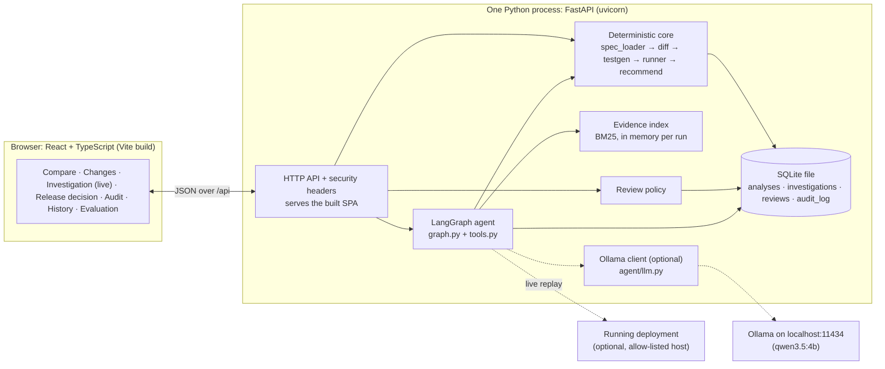
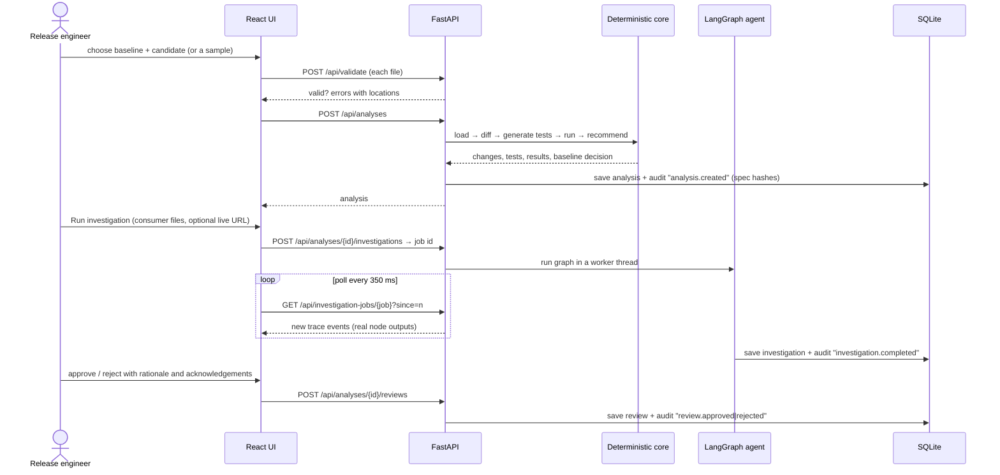
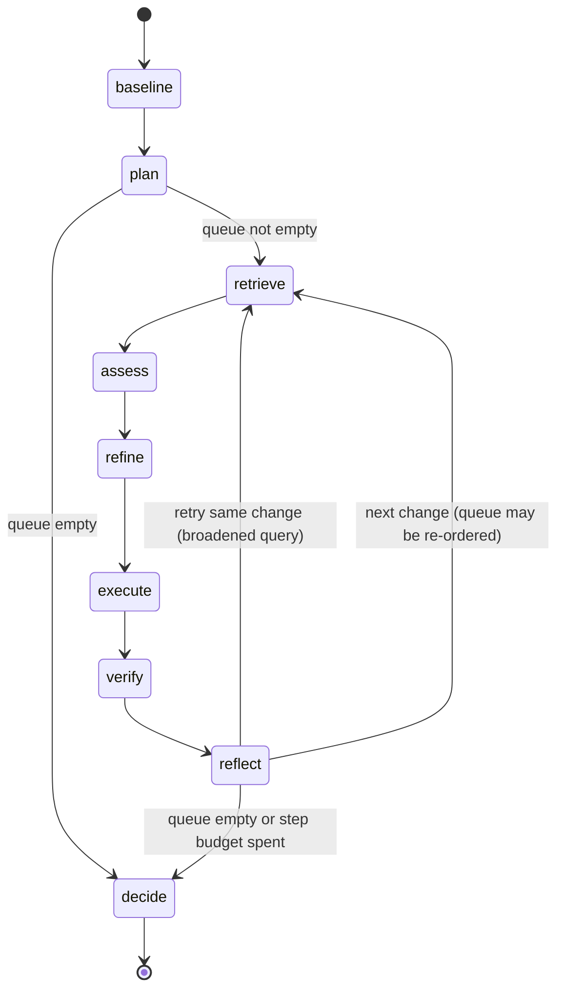
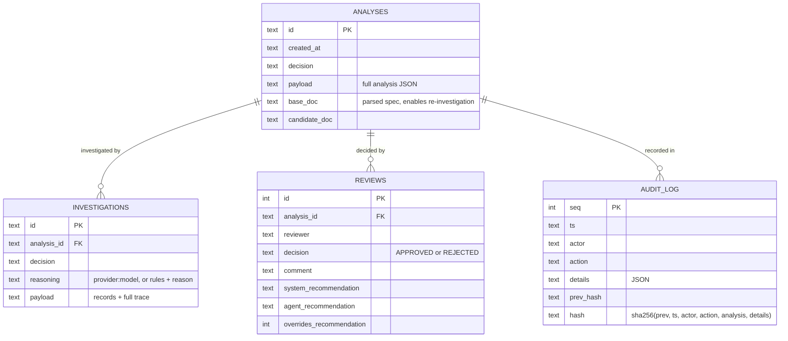

# API Sentinel — Architecture and Design (Review 2)

API Sentinel is a release gate for REST APIs. It compares two OpenAPI 3.0/3.1 specifications: the **baseline**, which is
the contract clients use today, and the **candidate**, which is the contract about to be released. It detects every
structural change and runs a targeted compatibility test for each one. It then investigates the uncertain changes
against evidence from consumer code, and recommends **PROCEED**, **HUMAN_REVIEW** or **BLOCK**. A named person makes
the final release decision. Every step is recorded in a tamper-evident audit log.

This document describes the code as it is. Anything not implemented is listed under [Future work](#12-implemented-vs-future-work).

---

## 1. Requirements

| ID | Requirement | Where it is implemented |
|----|-------------|-------------------------|
| F1 | Upload two specs (YAML/JSON) or pick a bundled sample | `UploadView.tsx`, `POST /api/analyses`, `/api/analyses/sample/{name}` |
| F2 | Validate as OpenAPI 3.0.x/3.1.x with readable errors. Reject Swagger 2.0, AsyncAPI and external `$ref`s | `spec_loader.py` |
| F3 | Deterministic structural diff (paths, operations, parameters, bodies, responses, schemas, security, servers) | `diff.py` |
| F4 | Direction-aware classification (BREAKING / POTENTIALLY_BREAKING / NON_BREAKING) with stable rule IDs | `diff.py` |
| F5 | Generate **and execute** a targeted test per change | `testgen.py`, `instances.py`, `runner.py` |
| F6 | Recommendation traceable to changes and test results | `recommend.py` |
| F7 | Agentic investigation: plan, retrieve, assess, refine tests, execute, verify, reflect, decide | `agent/graph.py` (LangGraph) |
| F8 | Evidence retrieval over consumer code and specs | `evidence.py` (BM25) |
| F9 | Observable execution: live progress plus a full trace with mode, inputs, outputs and timings | job API in `main.py`, `AgentPanel.tsx` |
| F10 | Optional LLM reasoning with a local Ollama model, with model tool calling and graceful failure (rules-only fallback) | `agent/llm.py` |
| F11 | Optional live HTTP replay against a running deployment, guarded against SSRF | `agent/tools.py::live_request`, `check_target` |
| F12 | Human release decision with acknowledgement rules | `review.py`, `ReviewPanel.tsx` |
| F13 | Durable, tamper-evident audit trail | `store.py` |
| F14 | Labelled evaluation with baselines | `evaluation.py`, `docs/EVALUATION.md` |

**Non-functional:** runs on a Windows laptop with Python 3.10+ and Node 18+ and nothing else. Works with **no**
network or LLM. The deterministic core is reproducible. Never fabricate results: every trace event is emitted by
the node that ran.

**Out of scope:** GraphQL, gRPC, Swagger 2.0, AsyncAPI, multi-user authentication, hosted deployment.

---

## 2. System architecture

### Why this architecture

| Choice | Requirement it serves | Simpler or heavier alternative, and why not |
|--------|----------------------|----------------------------------------|
| FastAPI, one process | F1–F14 behind one API. Python is where LangGraph and the OpenAPI validators live | A microservice split has nothing to scale and adds ops |
| React + TypeScript + Vite, served by FastAPI after `npm run build` | A modern SPA was required. One port, one command for the demo | A separate web server adds a moving part |
| Own diff engine | Rule IDs, request/response direction and explanations are the product (F3/F4) | Off-the-shelf diff tools give no executable tests and no direction-aware messages |
| Contract tests that validate generated messages with OAS-aware JSON Schema validators | F5 must *run* without a deployment | Live-only tests would need infrastructure for every review |
| LangGraph `StateGraph` | F7/F9: explicit nodes and conditional edges give an inspectable control flow | Hand-rolled loops hide the control flow. A multi-agent setup adds coordination with no requirement behind it |
| BM25 in process | F8: the corpus per run is small, and evidence hinges on exact identifiers (`trackingUrl`, `getOrder`) | A vector DB plus embedding model means a download, a service and a fuzzier match on identifiers |
| SQLite (`sqlite3` from the standard library) | F12/F13 must survive restarts | PostgreSQL or Redis are unjustified for a single-user local tool |
| No Docker | Nothing above needs a container | n/a |

---

## 3. End-to-end workflow

---

## 4. The LangGraph investigation graph

| Node | Mode | Input → output |
|------|------|----------------|
| `baseline` | tool | The deterministic analysis → a trace event with its decision, reasons and counts |
| `plan` | rules | Changes plus test outcomes → a prioritised queue: unconfirmed breaking, potentially breaking, unexpected failures, confirmed breaking (to find who is affected). At most 20 targets |
| `retrieve` | tool | Change → BM25 query (attempt 1 is *focused*: field, component, path. The retry is *broadened*: adds the operationId/SDK method name, tags and summary words) → top-k consumer chunks plus spec chunks |
| `assess` | rules or LLM | Change, test summary and evidence → impact and findings, each citing a chunk. With an LLM, the model may first **call tools** (`search_evidence`, `get_chunk`: read-only, executed by the app, at most 3 rounds and 6 calls), then answers in JSON. The reply is validated against the schema, and malformed findings are dropped and listed. The rules run alongside as a cross-check. Model failures are classified, and the agent falls back to rules |
| `refine` | rules | Verified-to-be findings → new tests: a *consumer expectation* (base schema tightened with what the cited code relies on), a *consumer request replay* (the literal value the code sends), and a *live HTTP* replay if a target is set |
| `execute` | tool | Refined tests → results: passed / failed / inconclusive / timeout / infra_error / error |
| `verify` | rules | Re-reads every finding against its cited chunk (LLM quotes must appear **verbatim**) and checks the file really calls the affected operation. Unverified findings are discarded. A model "impact" with no verifiable finding becomes *unverified_model_claim*. A model "no impact" that the rules contradict becomes *contradictory_evidence*. Both stay at human review |
| `reflect` | rules | The record → one of: **retry** the change (no verified usage and attempts left), **next** change, **replan** (move same-operation changes forward after a confirmed consumer), or **stop** (queue empty or step budget spent) |
| `decide` | rules | Records → the revised recommendation (policy below) |

**Bounded retries and stopping.** Each change gets at most `MAX_RETRIES = 1` extra retrieval. An investigation makes
at most `STEP_BUDGET = 28` retrieve calls, and the remaining changes are reported as skipped with the reason. After a
*fatal* LLM error (authentication, quota, model, connection), the model is not called again in that run.

**Measured effect of the agentic patterns** (from `docs/EVALUATION.md`, rules mode):
* **Verification** (the operation-call check plus verbatim citations): keyword retrieval without it falsely escalates the
  decoy case and has 43% impact precision. The agent has 100% precision and no false escalations.
* **Bounded retry**: on `orders-noisy-consumers`, consumer code is buried among six unrelated services. With retries
  disabled, the agent misses C005 (impact recall 83%). With one broadened retry it finds C005 (impact recall 100%).

---

## 5. Tool inventory

| Tool (code) | Input | Output | Side effects |
|-------------|-------|--------|--------------|
| `spec_loader.load_spec` | bytes, filename | `LoadedSpec` (valid, version, errors with locations, stats) | none |
| `diff.diff_specs` | base doc, candidate doc | `Change[]` (rule, severity, direction, location, before/after) | none |
| `testgen.generate_tests` | docs, changes | `TestCase[]` (kind, targeted payload, prediction) | none |
| `runner.run_tests` | docs, tests | `TestResult[]` (status, observed, verdict, errors) | none |
| `evidence.EvidenceIndex.search` | query terms, k, kinds | ranked chunks with citations (`file:start-end`) | none |
| `tools.rule_findings` | change, chunks | findings (reads field / no null check / enumerates values / calls SDK method …) | none |
| `tools.derive_consumer_schema` + `validate_against_derived` | base schema, findings, payload | validation errors under the consumer's real expectations | none |
| `tools.live_request` | allow-listed URL, test, change | HTTP request and reply, judged by the **old** contract | outbound HTTP, 5 s timeout, no redirects, no credentials |
| `llm.OllamaClient` (native `/api/chat`, `chat(messages, tools)`) | messages, optional tool schemas | content + tool calls, or a classified `LLMError` | HTTP to the local Ollama server |
| model-callable `search_evidence(query, source, k)` / `get_chunk(chunk_id)` | JSON arguments from the model, validated | chunk ids, citations, text | none (read-only over this run's index) |

---

## 6. Knowledge base and provenance (agentic RAG)

| Source | How it enters | Chunking | Provenance shown |
|--------|---------------|----------|-------------------|
| Consumer code, logs and docs uploaded with the investigation (≤ 25 files, ≤ 1 MB each, text only) | multipart upload, basename only | overlapping line windows | `file.py:8-15` plus line numbers on each cited line |
| Bundled sample consumers (`backend/samples/*/context/`) | used when no files are uploaded | same | same |
| Both specifications | always indexed | per operation | `base spec › GET /orders/{orderId}` |

Retrieval is BM25 with an identifier-aware tokenizer (`trackingUrl` → `tracking`, `url`, `trackingurl`). Spec chunks are
retrieved separately, so consumer code is never crowded out. Retrieval results are **not** trusted by themselves: a
consumer finding counts only if `verify` confirms the cited lines exist in the chunk, and that the same file calls the
affected operation by path plus HTTP method or by the SDK method named after its operationId.

---

## 7. Decision policy and human oversight

**Baseline (`deterministic-v1`):**
1. A BREAKING change with a **failing** contract test gives **BLOCK**.
2. Otherwise, any BREAKING change not confirmed, any POTENTIALLY_BREAKING change, an unexpected failure or a test error gives **HUMAN_REVIEW**.
3. Otherwise, **PROCEED**.

**Agent (`agent-v1`):**
* **Escalation** to BLOCK only on *verified* consumer evidence plus a *failing* refined test, or on a failing live replay.
* **De-escalation** (HUMAN_REVIEW → PROCEED) only when *every* change that triggered review has verified no-impact evidence.
* A baseline **BLOCK is never relaxed**: neither the model nor anything else can turn a test-confirmed break into a pass.
  This is covered by `test_llm_cannot_overturn_a_verified_block`.
* The agent never releases anything. Its output is advice.

**Human decision (`review.py`):** a named reviewer approves or rejects with a written rationale. Approving against
BLOCK, or under HUMAN_REVIEW, requires ticking each change the recommendation rests on. Overriding BLOCK needs a
rationale of at least 40 characters, and is flagged as an override. A decision made against a recommendation that has
changed since the page loaded is refused (409).

---

## 8. Data flow and persistence

* One SQLite file: `backend/data/sentinel.db` (or `SENTINEL_DB_PATH`).
* The audit log is append-only, enforced by triggers, and hash-chained. `GET /api/audit/verify` recomputes the chain.
* Audited actions: `analysis.created` (with SHA-256 of both specs), `analysis.rejected`, `investigation.completed`,
  `investigation.refused`, `review.approved`, `review.rejected`, `llm.check`.
* Investigation **jobs** (live progress) are in memory only. The finished investigation is persisted.
* Uploaded consumer files are used in memory for one run and are **not** stored. The trace keeps cited excerpts.

---

## 9. LLM integration

* Provider selection: Ollama is the only LLM runtime. `SENTINEL_LLM_PROVIDER=ollama` (alias `local`; `LLM_PROVIDER` is
  accepted as an alias of the variable) enables it; without it, or with `SENTINEL_LLM=off`, the agent runs in rules-only
  mode. Any other provider name is refused with a configuration message and rules-only mode. Ollama is never assumed to
  be installed. `OLLAMA_MODEL` (default `qwen3.5:4b`) selects the model; `SENTINEL_LLM_MODEL` is a fallback name.
* **Ollama (local):** a small dedicated adapter on the native API rather than Ollama's OpenAI-compatible `/v1`
  endpoint, because only the native API sets the context size (`options.num_ctx`; Ollama defaults to 4096 tokens
  on GPUs under 24 GB, which would silently truncate evidence-heavy prompts), `format`, and `think`.
  * Request: `POST {OLLAMA_BASE_URL}/api/chat` with `stream: false`, `options {temperature, num_ctx}`, `keep_alive`,
    `think: false` (dropped once and remembered if the model has no thinking mode), `tools` for tool rounds, and
    `format: "json"` for JSON-only calls and the final answer after tool rounds (never together with `tools`, which
    would suppress tool calls).
  * Tool calls arrive with **object** arguments; the adapter converts them to the JSON strings the shared tool loop
    validates, and converts the history back (assistant `tool_calls` with object arguments, `role: tool` results with
    `tool_name`). The tools themselves, their validation and budgets are the shared ones.
  * Error mapping: connection refused / connect timeout → `unavailable`; 404 or "not found, try pulling" →
    `model_missing` (message includes `ollama pull <model>`); read timeout (`OLLAMA_TIMEOUT`, default 180 s) →
    `timeout`; "requires more system memory" / CUDA out of memory → `resources`; other 5xx → `model_error`; non-JSON or
    empty reply → `bad_response`. All are fatal for the run (circuit breaker), so a slow model costs one timeout.
  * `GET /api/llm/status` checks the runtime **without inference or download** (`/api/version`, `/api/tags`,
    `/api/show` for capabilities) and returns the most recent check, self-test and investigation results kept in
    memory since start. The investigation record carries `llm.mode`: `llm_assisted`, `partial_fallback`,
    `rules_fallback`, `rules_only` or `llm_not_needed`.
* Settings are read from `backend/.env`. **The `.env` file wins over machine-wide environment variables**, so a stale
  global variable cannot silently override the project's configuration.
* Calls are made server-side only, to the configured Ollama server. Error messages pass through a redactor.
* `POST /api/llm/check` makes one minimal real request (**Test connection**). `POST /api/llm/selftest` runs **A** basic
  inference, **B** a schema-validated assessment of a real sample change, and **C** a real tool-call round trip
  (**Run self-test**). Results carry `live: false` whenever a test transport was injected, so mocked runs are never
  reported as live.
* The trace marks each `assess` step `llm` or `rules`. The investigation records how many assessments the model made, how
  many failed, and why it was disabled.

---

## 10. Security (summary)

See [`SECURITY.md`](SECURITY.md). In short: upload size, alias, node-count and depth limits; external `$ref`s never
fetched; filename sanitising; a strict CSP and security headers; outbound live tests restricted to allow-listed hosts
with no redirects and no credentials; local-only model calls; an append-only, hash-chained audit log.
**There is no authentication**: reviewer names are self-asserted, and the server is meant to bind to `127.0.0.1`.

---

## 11. Evaluation methodology

See [`EVALUATION.md`](EVALUATION.md), generated by `python -m app.evaluation`.

* **Change detection:** 21 labelled spec mutations (OAS 3.0 and 3.1), including traps. Metrics: change precision and
  recall, severity accuracy, decision accuracy. **Baselines** over the same detected changes: a naive gate (anything
  non-additive blocks) and severity without contract tests.
* **Investigation:** 6 cases with real, noisy, decoy or no consumer code. Affected changes were labelled by reading the
  code. Metrics: decision accuracy, false escalations, and per-change impact precision and recall. **Baselines:** deterministic
  only, keyword RAG without verification, and the agent with retries disabled.
* The corpus is small and was written alongside the engine, so the numbers show regression coverage and the
  effect of each pattern, not general superiority. The LLM path is not in these numbers.

---

## 12. Implemented vs future work

**Implemented and verified:** everything in sections 1–11. 154 automated backend tests, the self-checking `demo.py`, the
evaluation corpus, and a real-browser walkthrough.

**Not done (future work):**
* An evaluation of the LLM assessment path (for example the local `qwen3.5:4b`) on the same corpus. The Ollama adapter is
  covered by mocked tests only; real local inference has to be validated on a machine running Ollama.
* Authentication and roles for reviewers, and signed audit-chain checkpoints.
* Streaming with server-sent events instead of polling (polling every 350 ms is sufficient locally).
* Embedding retrieval as a complement to BM25, if real consumer corpora show vocabulary mismatch.
* Multi-file specs (external `$ref` bundling) and an import from Git history.
